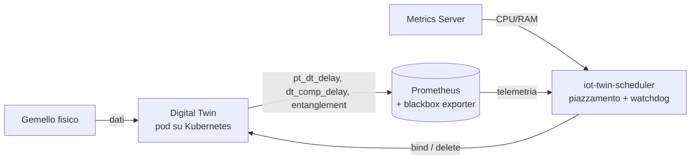

# DT Context-Aware Scheduler: orchestratore telemetry-driven per Digital Twin

Orchestratore per Kubernetes pensato per carichi **Digital Twin (DT)** in ambienti IoT/edge. Piazza i twin sui nodi usando **telemetria reale** (carico, latenza di rete, temperatura, disco) e ne **preserva l'entanglement**, cioè l'allineamento con il gemello fisico, migrando i workload che si desincronizzano.

---

## Lo scopo in breve

Un Digital Twin è utile solo se resta allineato al dispositivo fisico che rappresenta. Questo allineamento dipende da due cose, entrambe legate al nodo su cui il pod gira:

- la **rete**: quanto tempo impiega il dato a viaggiare dal dispositivo fisico al twin (`pt_dt_delay`);
- il **calcolo**: quanto tempo il twin impiega a elaborarlo (`dt_comp_delay`).

La loro somma è l'**entanglement**. Lo scheduler nativo di Kubernetes non vede nessuna delle due cose, perché ragiona su richieste e limiti dichiarati nei manifest. Questo progetto sì, e fa tre cose:

1. **Piazza i twin in base al contesto.** Sceglie il nodo combinando carico reale di CPU/RAM con la strategia richiesta dal pod: latenza verso un IP, temperatura o carico del disco.
2. **Sorveglia l'entanglement.** Un thread interno controlla le metriche dei twin in esecuzione. Se l'entanglement supera la soglia in modo persistente, avvisa e poi fa ricreare il pod.
3. **Ripiazza in modo mirato.** Se il ritardo viene soprattutto dalla rete, il twin viene ripiazzato minimizzando la latenza. Se viene dal carico del nodo, si dà più peso a CPU e RAM.

I **vincoli hardware** richiesti dal pod (per esempio una GPU specifica) sono rigidi e valgono sempre, anche dopo una migrazione.



---

## Struttura del repository

```
.
├── scheduler/            # codice dello scheduler (src, Dockerfile, requirements)
├── deployment/           # manifest di deploy dello scheduler (RBAC, Deployment)
├── monitoring-stack/     # Prometheus, blackbox exporter, PodMonitor dei twin
├── digital-twin/         # Digital Twin di esempio
├── physical-twin/        # controparte fisica del twin
├── entanglement-plotter/ # visualizzazione dell'entanglement
├── experiment/           # esperimenti e valutazione
├── test/                 # test
└── README.md
```

## Documentazione

| Sezione | Cosa trovi |
|---|---|
| [`scheduler/README.md`](scheduler/README.md) | Architettura dello scheduler, flussi di scheduling e di migrazione, strategie, annotation, configurazione e limiti noti. **Da leggere per scrivere il manifest di un twin.** |
| [`monitoring-stack/README.md`](monitoring-stack/README.md) | Stack di telemetria: installazione, target di latenza, requisiti sui twin, verifica delle metriche e risoluzione dei problemi. |
| [`deployment/README.md`](deployment/README.md) | Deploy dello scheduler nel cluster (RBAC e Deployment). |

---

## Guida rapida

L'ordine conta: prima lo stack di monitoraggio, poi lo scheduler, infine i twin.

### Prerequisiti

- Un cluster Kubernetes (per esempio K3s) con `kubectl` e **Helm 3** configurati.
- **Metrics Server** attivo. Verifica con `kubectl top nodes`: se risponde con errore, lo scheduler non avrà i dati di CPU/RAM.
- Docker e un registry raggiungibile dai nodi, solo se vuoi costruire tu l'immagine dello scheduler (altrimenti usa `aprozzo/iot-twin-scheduler:v0.3`).
- Gli IP dei dispositivi fisici devono rispondere al ping **dai nodi del cluster**.

### 1. Stack di monitoraggio

```bash
cd monitoring-stack

helm repo add prometheus-community https://prometheus-community.github.io/helm-charts
helm repo update

helm install kube-prom-stack prometheus-community/kube-prometheus-stack \
  -n monitoring --create-namespace \
  -f prom-stack-values.yaml
```

Attendi che i pod in `monitoring` siano pronti (`kubectl -n monitoring get pods`). Poi **inserisci gli IP dei tuoi dispositivi fisici** nel `ServiceMonitor` in fondo a `blackbox-deamonset.yaml` e applica:

```bash
kubectl apply -f blackbox-deamonset.yaml
kubectl apply -f twin-pod-monitor.yaml
```

Dettagli, verifica delle metriche e risoluzione dei problemi: [`monitoring-stack/README.md`](monitoring-stack/README.md).

### 2. Scheduler

Se i twin richiedono hardware specifico, dichiaralo una tantum sui nodi che lo possiedono:

```bash
kubectl annotate node <nome-nodo> iot-scheduler/hw-tags="gpu-jetson-nano,camera-csi" --overwrite
```

L'immagine dello scheduler è **già disponibile nel registro** come `aprozzo/iot-twin-scheduler:v0.3`: puoi usarla direttamente in `deployment/scheduler-deploy.yaml` senza costruirla.

```yaml
image: aprozzo/iot-twin-scheduler:v0.3
```

Se invece vuoi costruirla tu (per esempio dopo aver modificato il codice), costruisci e pubblica la tua versione e imposta quel nome di immagine nel Deployment:

```bash
docker build -t <registry>/iot-twin-scheduler:<tag> scheduler/
docker push <registry>/iot-twin-scheduler:<tag>
```

Poi applica RBAC e Deployment:

```bash
kubectl apply -f deployment/rbac.yaml
kubectl apply -f deployment/scheduler-deploy.yaml
```

Verifica che il pod sia in esecuzione e che i log mostrino l'avvio del loop principale:

```bash
kubectl get pods -A | grep scheduler
kubectl logs -n <namespace-dello-scheduler> <nome-pod-scheduler>
```

Dettagli sul deploy: [`deployment/README.md`](deployment/README.md).

### 3. Digital Twin gestiti dallo scheduler

Da questo momento, **ogni Digital Twin che esporta le metriche `pt_dt_delay`, `dt_comp_delay` e `entanglement` e che viene deployato con questo scheduler è gestito dall'orchestratore**: piazzato in base alla telemetria e tenuto sotto controllo. Se il suo entanglement resta sopra soglia, viene migrato su un nodo più adatto.

Per questo il manifest del twin deve:

- usare `schedulerName: iot-twin-scheduler`;
- essere una **StatefulSet** (il nome stabile del pod permette allo scheduler di riconoscere il pod ricreato dopo una migrazione);
- avere la label `app` con uno dei valori elencati nel PodMonitor (`digital-twin-custom` o `digital-twin-default`);
- esporre le metriche su una porta chiamata `metrics`;
- dichiarare, se servono, strategia, hardware richiesto e soglia di entanglement tramite annotation.

Esempio minimo:

```yaml
apiVersion: apps/v1
kind: StatefulSet
metadata:
  name: twin-a
  namespace: default
spec:
  serviceName: twin-a
  replicas: 1
  selector:
    matchLabels:
      app: digital-twin-custom
  template:
    metadata:
      labels:
        app: digital-twin-custom
      annotations:
        iot-scheduler/strategy: "minimize-latency"            # strategia di piazzamento
        iot-scheduler/strategy-target: "192.168.0.66"         # IP verso cui minimizzare la latenza
        iot-scheduler/hw-required: "gpu-jetson-nano"          # hardware richiesto (opzionale)
        iot-scheduler/entanglement-threshold-ms: "300"        # soglia di entanglement (opzionale)
    spec:
      schedulerName: iot-twin-scheduler
      containers:
        - name: twin
          image: <registry>/digital-twin:<tag>
          ports:
            - name: metrics
              containerPort: 8000   # la porta su cui il twin espone /metrics
```

Il valore di `strategy-target` deve coincidere con uno degli IP configurati nel blackbox exporter. Tutte le annotation disponibili, i valori di default e il comportamento in caso di dati mancanti sono descritti in [`scheduler/README.md`](scheduler/README.md).

### Verifica end-to-end

1. In Prometheus (`kubectl -n monitoring port-forward svc/prometheus-operated 9090:9090`), **Status → Targets** mostra i target del blackbox e dei twin in stato `UP`, e `entanglement{pod="twin-a-0"}` restituisce un valore.
2. Nei log dello scheduler compare la scelta del nodo per il pod del twin.
3. `kubectl describe pod twin-a-0` mostra, se l'entanglement degrada in modo persistente, un evento `EntanglementDecayed` di preavviso. Dopo il periodo di grazia il pod viene ricreato e piazzato di nuovo.