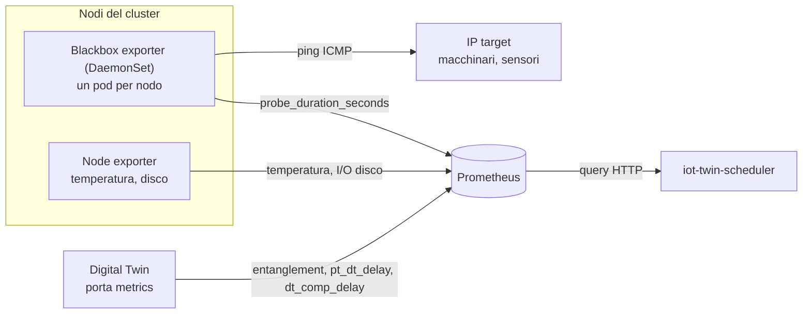

# Monitoring Stack

Stack di monitoraggio che fornisce la **telemetria** su cui si basa l'`iot-twin-scheduler`. Senza questi componenti lo scheduler continua a funzionare, ma non vede latenza, temperatura, carico dei dischi ed entanglement dei twin: le strategie ripiegano sul solo carico CPU/RAM o sul round-robin.

---

## Contenuto della cartella

| File | Cosa fa |
|---|---|
| `prom-stack-values.yaml` | Values Helm di **kube-prometheus-stack**: installa Prometheus, Prometheus Operator, node exporter, kube-state-metrics e Grafana. |
| `blackbox-daemonset.yaml` | **Blackbox exporter** (un pod per nodo) più il `ServiceMonitor` che lo fa sondare gli IP target. Produce la latenza nodo → target. |
| `twin-pod-monitor.yaml` | **PodMonitor** che dice a Prometheus di raccogliere le metriche esposte dai Digital Twin. |

Cosa **non** è incluso: il **Metrics Server** (serve allo scheduler per CPU/RAM reali, vedi [Prerequisiti](#prerequisiti)) e l'esportazione delle metriche di entanglement da parte dei twin, che è parte dell'applicazione dei twin stessi.

---

## Come si collega allo scheduler



Lo scheduler interroga Prometheus all'indirizzo `http://prometheus-operated.monitoring.svc.cluster.local:9090` (il default della variabile `PROMETHEUS_URL`), che corrisponde al Service creato da questo stack nel namespace `monitoring`.

### Metriche attese dallo scheduler

| Metrica | Prodotta da | Label richieste | Usata da |
|---|---|---|---|
| `probe_duration_seconds` | blackbox exporter | `kubernetes_node` (nodo di partenza della sonda), `instance` (IP del target) | strategia `minimize-latency` |
| `node_hwmon_temp_celsius` | node exporter | `instance` (IP del nodo) | strategia `temperature-aware` |
| `node_disk_io_time_seconds_total` | node exporter | `instance`, `device` | strategia `disk-io-aware` |
| `entanglement`, `pt_dt_delay`, `dt_comp_delay` | Digital Twin | `pod`, `namespace` | watchdog |

Le query esatte usate dallo scheduler sono nella sezione [Verifica](#verifica).

### Come nascono le label del blackbox

Il `ServiceMonitor` in `blackbox-daemonset.yaml` fa due cose per ogni target:

- passa a ogni pod blackbox il parametro `target` (l'IP da sondare) e il modulo `icmp_ping`;
- tramite relabeling scrive in `kubernetes_node` il nome del nodo su cui gira il pod che esegue la sonda, e sovrascrive `instance` con l'IP del target.

Il risultato è una serie per ogni coppia nodo × target, ad esempio `probe_duration_seconds{kubernetes_node="nodo-1", instance="192.168.0.66"}`. È ciò che permette allo scheduler di rispondere alla domanda "quale nodo è più vicino a questo IP?".

---

## Prerequisiti

- Un cluster Kubernetes con **Helm 3** e `kubectl` configurati.
- Una StorageClass `local-path` (inclusa in K3s). Con un'altra StorageClass, modificala in `prom-stack-values.yaml` (due punti: Grafana e Prometheus).
- **Metrics Server** attivo (K3s lo include). Verifica con:
  ```bash
  kubectl top nodes
  ```
  Se il comando restituisce errore, lo scheduler non avrà i dati di CPU/RAM.
- Gli IP target devono rispondere al ping **dai nodi del cluster**. Se un dispositivo blocca l'ICMP, la sonda fallirà.

---

## Deploy

L'ordine conta: prima Prometheus (che installa le CRD `ServiceMonitor` e `PodMonitor`), poi il resto.

### 1. Prometheus e componenti

```bash
helm repo add prometheus-community https://prometheus-community.github.io/helm-charts
helm repo update

helm install kube-prom-stack prometheus-community/kube-prometheus-stack \
  -n monitoring --create-namespace \
  -f prom-stack-values.yaml
```

Il nome della release (`kube-prom-stack`) è quello usato come label nel `ServiceMonitor`. Per riproducibilità puoi fissare anche la versione del chart con `--version <x.y.z>`.

Attendi che i pod siano pronti:

```bash
kubectl -n monitoring get pods
```

### 2. Blackbox exporter

Prima di applicarlo, **sostituisci gli IP dei target** nel `ServiceMonitor` in fondo al file (vedi [Aggiungere o cambiare i target](#aggiungere-o-cambiare-i-target)).

```bash
kubectl apply -f blackbox-daemonset.yaml
```

Controlla che ci sia un pod per ogni nodo che lo scheduler considera idoneo:

```bash
kubectl -n monitoring get pods -l app=blackbox-exporter -o wide
```

### 3. Metriche dei Digital Twin

```bash
kubectl apply -f twin-pod-monitor.yaml
```

### Aggiornare la configurazione

```bash
# values di Prometheus
helm upgrade kube-prom-stack prometheus-community/kube-prometheus-stack \
  -n monitoring -f prom-stack-values.yaml

# moduli del blackbox (ConfigMap montata con subPath: non si ricarica da sola)
kubectl apply -f blackbox-daemonset.yaml
kubectl -n monitoring rollout restart daemonset/blackbox-exporter
```

---

## Accessi

| Servizio | Come raggiungerlo |
|---|---|
| Grafana | `http://<ip-di-un-nodo>:32002` (utente `admin`, password `admin`) |
| Prometheus | `kubectl -n monitoring port-forward svc/prometheus-operated 9090:9090`, poi `http://localhost:9090` |

---

## Aggiungere o cambiare i target

I target di latenza sono elencati nel `ServiceMonitor` di `blackbox-daemonset.yaml`, un blocco per ogni IP. Per aggiungerne uno, copia un blocco e cambia solo `target`:

```yaml
  - port: http
    path: /probe
    interval: 10s
    params:
      module: [icmp_ping]
      target: [192.168.0.77]      # nuovo IP
    relabelings:
    - sourceLabels: [__meta_kubernetes_pod_node_name]
      targetLabel: kubernetes_node
    - sourceLabels: [__param_target]
      targetLabel: instance
```

Poi `kubectl apply -f blackbox-daemonset.yaml`.

L'IP scritto qui è lo stesso da usare nell'annotation `iot-scheduler/strategy-target` del pod. Se il valore non coincide con nessun `instance`, la query della latenza non restituisce risultati e lo scheduler ripiega sul solo carico CPU/RAM.

Senza `strategy-target`, lo scheduler usa la media su **tutti** i target sondati da ciascun nodo.

---

## Requisiti sui Digital Twin

Perché il `PodMonitor` raccolga le metriche dei twin:

1. i pod hanno la label `app` con uno dei valori elencati nel `PodMonitor` (di default `digital-twin-custom` o `digital-twin-default`), nel template della StatefulSet;
2. il container espone una porta con **nome** `metrics`;
3. i pod stanno nello stesso namespace del `PodMonitor` (`default`). Altrimenti decommenta `namespaceSelector` nel file;
4. l'applicazione non esporta label proprie chiamate `pod` o `namespace`: Prometheus le rinominerebbe in `exported_pod` e `exported_namespace`, e il watchdog non troverebbe le metriche.

Esempio dei punti 1 e 2 nel template di una StatefulSet:

```yaml
    metadata:
      labels:
        app: digital-twin-custom
    spec:
      containers:
        - name: twin
          ports:
            - name: metrics
              containerPort: 8000   # la porta della tua applicazione
```

---

## Verifica

Apri un port-forward verso Prometheus e usa la UI oppure `curl`:

```bash
kubectl -n monitoring port-forward svc/prometheus-operated 9090:9090

curl -s 'http://localhost:9090/api/v1/query' \
  --data-urlencode 'query=probe_success'
```

### 1. Il blackbox riesce a fare ping?

Dal pod, senza passare da Prometheus:

```bash
kubectl -n monitoring port-forward svc/blackbox-exporter 9115:9115
curl "http://localhost:9115/probe?module=icmp_ping&target=192.168.0.66"
```

Nell'output cerca `probe_success 1`.

### 2. Prometheus scrapa i target?

In Prometheus: **Status → Targets**. Devono comparire:

- `serviceMonitor/monitoring/blackbox-exporter-ping/*`: un endpoint per ogni coppia nodo × target, tutti `UP`;
- `podMonitor/default/digital-twin-monitor/*`: un endpoint per ogni twin in esecuzione.

### 3. Le query dello scheduler restituiscono dati?

| Query | Risultato atteso |
|---|---|
| `probe_success` | `1` per ogni coppia nodo × target |
| `avg(probe_duration_seconds{instance="192.168.0.66"}) by (kubernetes_node)` | una riga per ogni nodo (`minimize-latency` con target specifico) |
| `avg(probe_duration_seconds) by (kubernetes_node)` | una riga per ogni nodo (`minimize-latency` senza target) |
| `avg(node_hwmon_temp_celsius) by (instance)` | una riga per ogni nodo (`temperature-aware`) |
| `sum(rate(node_disk_io_time_seconds_total{device=~"sd.*\|vd.*\|nvme.*\|mmcblk.*"}[2m])) by (instance)` | una riga per ogni nodo (`disk-io-aware`) |
| `entanglement{pod="twin-a-0", namespace="default"}` | un valore in millisecondi (idem per `pt_dt_delay` e `dt_comp_delay`) |

Nelle query con `instance` dei nodi, il valore è `<IP-nodo>:9100`: lo scheduler toglie la porta e lo confronta con l'IP interno del nodo. Confronta con:

```bash
kubectl get nodes -o wide
```

---

## Risoluzione dei problemi

| Sintomo | Causa probabile | Cosa fare |
|---|---|---|
| Nessun target blackbox o twin in **Status → Targets** | Prometheus non considera il `ServiceMonitor`/`PodMonitor` | Controlla che i values abbiano i tre `...SelectorNilUsesHelmValues: false` e rilancia `helm upgrade`. Verifica anche `kubectl get servicemonitor,podmonitor -A`. |
| Target del blackbox `UP` ma `probe_success` è `0` | Il pod non raggiunge l'IP, oppure il target blocca il ping | Prova il `curl` diretto al blackbox (punto 1 della verifica) e un ping dal nodo verso l'IP. |
| `probe_success` sempre `0` anche per IP raggiungibili | Il pod non ha il permesso di aprire socket ICMP | Verifica che `NET_RAW` sia presente nel `securityContext` del DaemonSet e guarda i log: `kubectl -n monitoring logs ds/blackbox-exporter`. |
| La query della latenza restituisce meno righe dei nodi | Manca il pod blackbox su qualche nodo (taint, nodo non pronto, architettura) | `kubectl -n monitoring get pods -l app=blackbox-exporter -o wide` e confronta con `kubectl get nodes`. Un nodo senza dati di latenza non vince mai con `minimize-latency`. |
| La query con `instance="<IP>"` è vuota | L'IP non coincide con quello scritto nel `ServiceMonitor` | Controlla l'IP in `strategy-target` e nel `ServiceMonitor`: devono essere identici. |
| Latenza molto alta (circa 3 s) per un nodo | La sonda va in timeout: il nodo non raggiunge il target | È un comportamento atteso: quel nodo perde la gara. Il timeout è il valore `timeout` del modulo `icmp_ping`. |
| `entanglement` non compare, ma i twin sono `Running` | Label `app` diversa, porta non chiamata `metrics`, namespace diverso | Rivedi i [Requisiti sui Digital Twin](#requisiti-sui-digital-twin). |
| `entanglement` compare ma il watchdog non agisce | Le label sono `exported_pod` / `exported_namespace` | Guarda le label della serie in Prometheus. L'applicazione non deve esportare label `pod` o `namespace` proprie. |
| `temperature-aware` non produce dati | Il nodo non espone sensori `hwmon` | Controlla con la query della tabella sopra. Alcune VM e alcuni kernel non li espongono. |
| Il log dello scheduler riporta `Prometheus fetch failed` | URL o namespace errato, oppure Prometheus non raggiungibile | Verifica `PROMETHEUS_URL` e `kubectl -n monitoring get svc prometheus-operated`. |

---

## Note sulla configurazione

Alcune scelte nei file sono adatte a un PoC e andrebbero riviste in un ambiente reale:

- Prometheus gira come **root** (`runAsUser: 0` nei values).
- Grafana ha password admin e il Service è esposto come NodePort per ragioni di sviluppo.
- Alertmanager è disabilitato.
- Retention di 7 giorni e 4 Gi di storage su `local-path`: lo spazio non è replicato, se il nodo si perde i dati vanno persi.
- Nel `ServiceMonitor` del blackbox, `interval: 10s` rende lo scheduler reattivo ai cambi di latenza; con molti target o molti nodi può essere alzato.