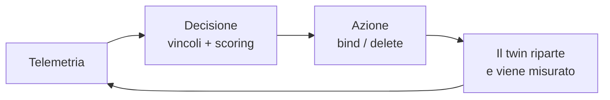
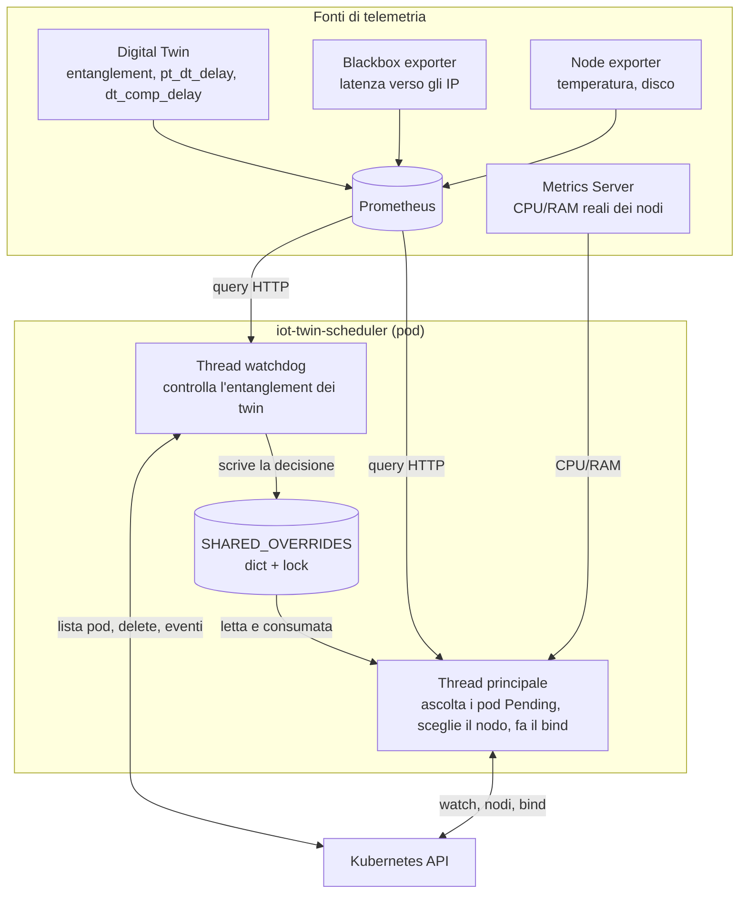
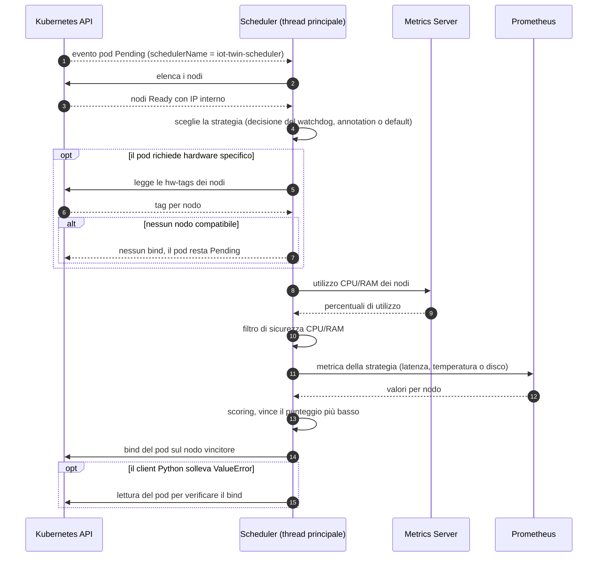
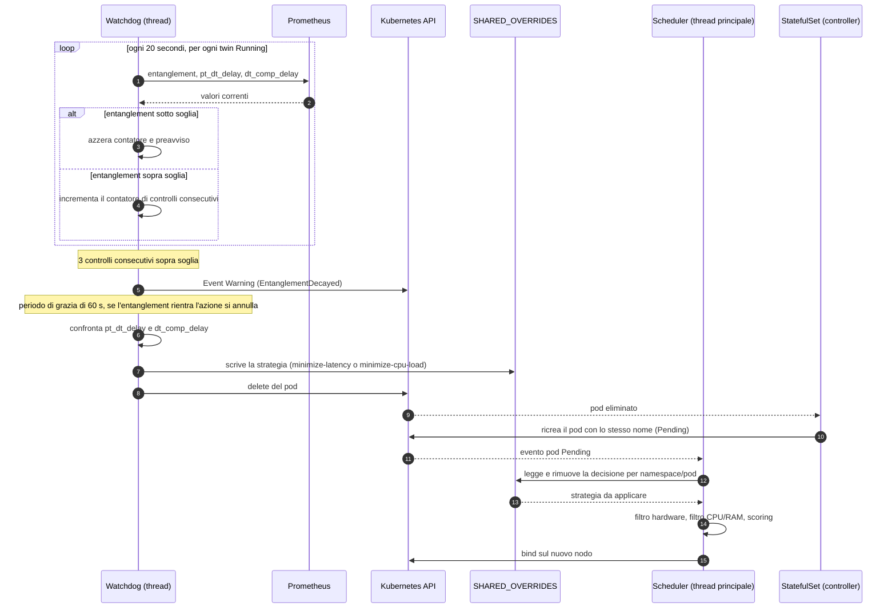

# IoT Twin Scheduler

**Middleware di orchestrazione context-aware e guidato dalla telemetria, per Digital Twin su Kubernetes.**

Si inserisce tra la creazione di un pod e la sua assegnazione a un nodo: al posto dello scheduler nativo, che decide in base a richieste e limiti scritti nei manifest, questo scheduler decide in base a **ciò che sta succedendo davvero** nel cluster e nella rete, in quel momento.

Due parole chiave per capirlo:

- **Context-aware**: il "contesto" è l'insieme delle condizioni che influenzano un Digital Twin: carico reale dei nodi, distanza di rete dal dispositivo fisico, temperatura e stress dei dischi, capacità hardware disponibili e, soprattutto, lo stato di allineamento tra il twin e il suo gemello fisico (l'**entanglement**).
- **Telemetry-driven**: ogni decisione parte da misure raccolte in tempo reale tramite **Prometheus**, **blackbox exporter** e **Metrics Server**, non da valori dichiarati a priori.

Il comportamento è un **ciclo chiuso**: lo scheduler osserva, decide, agisce e poi continua a osservare. Non si limita a piazzare un pod una volta: se un twin si desincronizza dalla sua controparte fisica, lo **migra** su un nodo più adatto.



---

## Indice

1. [Idea in breve](#idea-in-breve)
2. [Fonti di telemetria](#fonti-di-telemetria)
3. [Architettura](#architettura)
4. [Struttura del progetto](#struttura-del-progetto)
5. [Flusso 1: scheduling di un nuovo pod](#flusso-1-scheduling-di-un-nuovo-pod)
6. [Come viene scelto il nodo](#come-viene-scelto-il-nodo)
7. [Strategie disponibili](#strategie-disponibili)
8. [Flusso 2: monitoraggio dell'entanglement e migrazione](#flusso-2-monitoraggio-dellentanglement-e-migrazione)
9. [Annotation](#annotation)
10. [Configurazione](#configurazione)
11. [Metriche richieste](#metriche-richieste)
12. [Deploy](#deploy)
13. [Limiti noti](#limiti-noti)

---

## Idea in breve

Un Digital Twin è utile solo se resta allineato al dispositivo fisico che rappresenta. Questo allineamento dipende da due cose:

- la **rete**: quanto tempo impiega il dato a viaggiare dal dispositivo fisico al twin;
- la **capacità di calcolo**: quanto tempo il twin impiega a elaborare quel dato.

Entrambe dipendono da *dove* il pod è stato piazzato, e nessuna delle due è visibile in un manifest Kubernetes. Un nodo può avere molta CPU "libera sulla carta" ed essere in realtà saturo, oppure essere perfetto in termini di risorse ma lontano dal dispositivo fisico.

Lo scheduler affronta il problema con tre capacità, tutte nello stesso microservizio:

1. **Piazzamento consapevole del contesto.** Sceglie il nodo combinando carico reale, latenza, temperatura o carico disco, secondo la strategia richiesta dal pod.
2. **Preservazione dell'entanglement.** Un thread dedicato sorveglia i twin in esecuzione e, se l'allineamento peggiora in modo persistente, li fa ripiazzare altrove.
3. **Rispetto dei vincoli hardware.** Se un twin richiede un hardware specifico (una GPU, un sensore), quel requisito è rigido e vale sempre, anche dopo una migrazione.

### Il contesto, in sintesi

| Aspetto del contesto | Domanda a cui risponde | Fonte |
|---|---|---|
| Carico dei nodi | Quanta CPU e RAM sono davvero libere adesso? | Metrics Server |
| Rete | Quanto è vicino questo nodo al dispositivo fisico? | Blackbox exporter, via Prometheus |
| Stato fisico del nodo | Il nodo è troppo caldo? Il disco è saturo? | Node exporter, via Prometheus |
| Capacità hardware | Il nodo ha la GPU o il sensore richiesto? | Annotation del nodo |
| Salute del twin | Il twin è ancora allineato al suo gemello fisico? | Metriche esposte dal twin, via Prometheus |

---

## Fonti di telemetria

Lo scheduler non misura nulla da solo: si appoggia a strumenti standard dell'ecosistema Kubernetes e li interroga **al momento della decisione**. Non mantiene uno storico proprio.

### Prometheus

È il punto di raccolta centrale delle serie temporali. Lo scheduler lo interroga via HTTP (`/api/v1/query`) per ottenere:

- la latenza dei nodi verso un target (dal blackbox exporter);
- temperatura e carico dei dischi (dal node exporter);
- le metriche di entanglement dei Digital Twin.

### Blackbox exporter: la latenza verso gli IP

Il blackbox exporter è una **sonda attiva**: invece di leggere metriche già esistenti, "bussa" a un indirizzo (ping, richiesta HTTP o TCP) e misura quanto tempo impiega a rispondere. Il risultato è la metrica `probe_duration_seconds`.

È la base della strategia `minimize-latency`:

- le sonde misurano il tempo di risposta **da ciascun nodo** verso uno o più IP (ad esempio quello del dispositivo fisico che il twin rappresenta);
- lo scheduler legge questi valori e capisce **quale nodo è più vicino al target**;
- con l'annotation `iot-scheduler/strategy-target` il pod sceglie verso quale IP minimizzare la latenza; senza, si usa la media su tutti i target sondati.

Perché funzioni, la metrica deve portare la label `kubernetes_node` (in alternativa `instance`), così da poterla associare al nodo da cui parte la sonda.

### Node exporter

Fornisce lo stato fisico dei nodi: la temperatura (`node_hwmon_temp_celsius`) e il tempo di I/O dei dischi (`node_disk_io_time_seconds_total`), usati dalle strategie `temperature-aware` e `disk-io-aware`. Il pattern dei dischi include anche `mmcblk`, tipico delle schede SD/eMMC di Raspberry Pi e altre SBC.

### Metrics Server

Raccoglie dal kubelet di ogni nodo il consumo **istantaneo** di CPU e memoria. Lo scheduler lo confronta con la capacità allocabile del nodo e ricava la percentuale di utilizzo reale. Questo dato alimenta sempre il filtro di sicurezza e lo scoring, qualunque sia la strategia richiesta.

### Digital Twin

Ogni twin espone da sé tre metriche (`pt_dt_delay`, `dt_comp_delay`, `entanglement`), raccolte da Prometheus. Sono ciò che permette allo scheduler di sapere se il twin è ancora allineato al fisico. Il dettaglio è nel [Flusso 2](#flusso-2-monitoraggio-dellentanglement-e-migrazione).

---

## Architettura

Un unico microservizio, un unico container, due thread che comunicano direttamente in memoria (nessuna API esterna tra i due).



| Componente | Ruolo |
|---|---|
| **Thread principale** | Segue il watch dei pod, calcola il nodo migliore e fa il bind. |
| **Thread watchdog** | Controlla periodicamente l'entanglement dei twin; se serve, ne ordina la ricreazione. |
| **`SHARED_OVERRIDES`** | Dizionario condiviso, protetto da lock, con cui il watchdog dice allo scheduler *come* ripiazzare un twin. |
| **Prometheus** | Raccoglie e serve latenza, temperatura, carico disco ed entanglement. |
| **Blackbox exporter** | Misura la latenza dei nodi verso gli IP target. |
| **Node exporter** | Espone temperatura e I/O dei dischi dei nodi. |
| **Metrics Server** | Fornisce l'utilizzo reale di CPU e RAM dei nodi. |

---

## Struttura del progetto

```
.
├── Dockerfile
├── requirements.txt
└── src/
    ├── main.py                    # avvio, watch dei pod, bind, shutdown
    ├── config/
    │   └── config.py              # variabili d'ambiente, annotation, stato condiviso
    ├── core/
    │   ├── scheduler_engine.py    # scelta del nodo (filtri + scoring)
    │   └── watchdog_thread.py     # monitoraggio entanglement
    └── utils/
        ├── kubernetes_utils.py    # nodi, hw-tags, CPU/RAM, delete pod, eventi
        └── prometheus_utils.py    # query Prometheus
```

---

## Flusso 1: scheduling di un nuovo pod

Questo è il percorso di un pod che dichiara `schedulerName: iot-twin-scheduler`.



1. **Intercettazione.** Il thread principale ascolta gli eventi dei pod. Quando vede un pod `Pending` assegnato a questo scheduler e non ancora legato a un nodo, lo prende in carico.
2. **Nodi disponibili.** Elenca i nodi `Ready` e senza taint `NoSchedule` (così il control-plane viene escluso).
3. **Scelta della strategia.** Se per quel pod esiste una decisione del watchdog (vedi Flusso 2) viene usata quella; altrimenti si legge l'annotation `iot-scheduler/strategy`; in assenza di entrambe la strategia è `default`.
4. **Filtro hardware (rigido).** Se il pod richiede hardware specifico (`iot-scheduler/hw-required`), restano candidati solo i nodi che lo dichiarano (`iot-scheduler/hw-tags`). Se nessun nodo li soddisfa, il pod **resta Pending**: non esiste alcun fallback per un requisito hardware.
5. **Filtro di sicurezza CPU/RAM.** Vengono scartati i nodi sopra soglia (di default 85% di CPU o RAM). Se *tutti* i candidati sono sopra soglia, il filtro viene ignorato per non lasciare il pod bloccato.
6. **Scoring.** Tra i nodi rimasti si calcola un punteggio che combina la metrica della strategia con CPU e RAM (dettagli sotto). Vince il punteggio più basso.
7. **Bind.** Il pod viene assegnato al nodo vincitore. Se il client Python solleva il noto `ValueError` sul binding, il risultato viene verificato con una lettura del pod per confermare che sia davvero finito sul nodo atteso.

Il filtro hardware viene applicato **sempre**, anche quando un pod viene ripiazzato dopo una desincronizzazione: un twin che richiede una GPU non finirà mai su un nodo senza GPU.

---

## Come viene scelto il nodo

Per ogni nodo candidato vengono considerate tre componenti:

| Componente | Peso di default | Significato |
|---|---|---|
| Strategia | 0.6 | latenza, temperatura o carico disco, a seconda della strategia |
| CPU | 0.2 | utilizzo % della CPU rispetto alla capacità allocabile |
| RAM | 0.2 | utilizzo % della memoria rispetto alla capacità allocabile |

Ogni componente viene prima **normalizzata tra 0 e 1** sui nodi candidati (0 = il migliore, 1 = il peggiore), poi combinata:

```
score = (w_strategia · n_strategia + w_cpu · n_cpu + w_ram · n_ram) / (w_strategia + w_cpu + w_ram)
```

**Il nodo con lo score più basso vince.**

Alcune regole per i casi limite:

- Se una componente non ha dati per nessun nodo (ad esempio pod senza strategia, oppure Prometheus non raggiungibile), il suo peso viene azzerato e il punteggio si basa sulle componenti rimaste. Un pod senza annotation viene quindi valutato solo su CPU e RAM.
- Se a un singolo nodo mancano i dati di telemetria, riceve una penalità molto alta (`999`) e di fatto perde la gara.
- Se la telemetria fallisce per tutti i nodi, si ricade su un **round-robin** tra i candidati, così il carico non finisce sempre sullo stesso nodo.

---

## Strategie disponibili

La strategia si sceglie con l'annotation `iot-scheduler/strategy` sul pod.

| Strategia | Cosa minimizza | Metrica Prometheus |
|---|---|---|
| `minimize-latency` | latenza di rete verso il target | `probe_duration_seconds` (blackbox exporter) |
| `temperature-aware` | temperatura del nodo | `node_hwmon_temp_celsius` |
| `disk-io-aware` | tempo di I/O del disco (include `sd`, `vd`, `nvme`, `mmcblk`) | `node_disk_io_time_seconds_total` |
| `default` *(nessuna annotation)* | solo carico CPU/RAM | Metrics Server |
| `minimize-cpu-load` *(assegnata dal watchdog)* | carico CPU/RAM, ignorando la latenza | Metrics Server |

**Latenza verso un target specifico.** Con `minimize-latency` si può aggiungere `iot-scheduler/strategy-target` con l'IP o l'alias verso cui misurare la latenza (utile se il blackbox exporter sonda più destinazioni). Senza questa annotation si usa la media su tutti i target sondati da ciascun nodo.

**`minimize-cpu-load`** non è pensata per essere scelta a mano, anche se tecnicamente funziona: la usa il watchdog quando decide che un twin va spostato per un problema di carico. In questo caso i pesi diventano strategia 0, CPU 0.5, RAM 0.5.

---

## Flusso 2: monitoraggio dell'entanglement e migrazione

### Cosa viene misurato

Ogni Digital Twin espone via Prometheus tre metriche, in millisecondi, con le label `pod` e `namespace`:

| Metrica | Significato |
|---|---|
| `pt_dt_delay` | ritardo tra l'invio del dato dal dispositivo fisico e la ricezione da parte del twin |
| `dt_comp_delay` | tempo che il twin impiega a elaborare il dato e aggiornare il proprio stato |
| `entanglement` | somma delle due: è la metrica confrontata con la soglia |

### Cosa fa il watchdog

Il thread watchdog gira in un ciclo (ogni 20 secondi di default) sui pod `Running` gestiti da questo scheduler. Per ciascun twin:

1. **Cooldown.** Se il pod è stato appena ripiazzato, viene saltato per un po' (180 s di default), così ha il tempo di stabilizzarsi.
2. **Lettura.** Legge l'`entanglement` da Prometheus e lo confronta con la soglia del twin (annotation `iot-scheduler/entanglement-threshold-ms`, altrimenti 300 ms).
3. **Rientro.** Se il valore è sotto soglia, qualsiasi allarme in corso viene azzerato.
4. **Persistenza.** Se è sopra soglia, il controllo viene contato. Un singolo campione alto non basta: servono **3 controlli consecutivi** (evita di reagire ai picchi occasionali).
5. **Preavviso.** Al raggiungimento dei 3 controlli parte un **periodo di grazia** (60 s) e viene emesso un **Event Kubernetes** di tipo `Warning` sul pod, visibile con `kubectl describe pod`. In questa fase non viene toccato nulla.
6. **Decisione.** Se terminato il periodo di grazia l'entanglement è ancora alto, il watchdog guarda **quale delle due componenti pesa di più**:
   - prevale `pt_dt_delay` → il ritardo viene dalla rete → il twin va ripiazzato con `minimize-latency`;
   - prevale `dt_comp_delay` → il ritardo viene dal carico del nodo → il twin va ripiazzato con `minimize-cpu-load`.
7. **Comunicazione allo scheduler.** Il watchdog scrive la strategia scelta in `SHARED_OVERRIDES`, sotto la chiave `namespace/nome-pod`, protetta da lock.
8. **Eliminazione.** Il watchdog **cancella il pod**. È sempre lui a ordinare il delete, e solo dopo aver scritto la decisione.

Se in qualunque momento prima del delete (anche durante il periodo di grazia) l'entanglement rientra sotto soglia, l'azione viene annullata.

### Perché si cancella il pod invece di "spostarlo"

Un binding è un'operazione valida solo per un pod ancora `Pending`. Un pod già in esecuzione non può essere riassegnato a un altro nodo: l'unico modo è cancellarlo e lasciare che il suo controller lo ricrei. Per questo i Digital Twin vanno gestiti con una **StatefulSet**, che ricrea il pod con **lo stesso nome** (es. `twin-a-0`). Il nome stabile è ciò che permette allo scheduler di riconoscere il pod ricreato e di applicargli la decisione del watchdog.

### Cosa succede dopo il delete

1. La StatefulSet ricrea il pod, che nasce `Pending` con lo stesso nome.
2. Il thread principale lo intercetta come qualsiasi altro pod (Flusso 1).
3. Prima di scegliere la strategia, controlla `SHARED_OVERRIDES` e trova la decisione del watchdog per quel pod: la usa al posto dell'annotation originale.
4. Applica comunque il **filtro hardware**, il filtro di sicurezza CPU/RAM e lo scoring.
5. Dopo aver scelto il nodo, **rimuove la decisione** dal dizionario: vale una volta sola, così i riavvii successivi del pod tornano alla sua strategia originale.

### Riepilogo: chi fa cosa

| Azione | Chi la esegue |
|---|---|
| Rilevare la desincronizzazione | thread watchdog |
| Decidere come ripiazzare il twin | thread watchdog |
| Cancellare il pod | thread watchdog |
| Ricreare il pod | StatefulSet (controller Kubernetes) |
| Scegliere il nuovo nodo e fare il bind | thread principale (scheduler) |

### Sequenza completa



### Tempi indicativi (valori di default)

Dalla prima rilevazione sopra soglia, servono circa 40 s per raggiungere i 3 controlli consecutivi, più i 60 s del periodo di grazia: nell'ordine di un paio di minuti prima del delete.

---

## Annotation

### Sul pod (nel template della StatefulSet)

| Annotation | Valori | Descrizione |
|---|---|---|
| `iot-scheduler/strategy` | `minimize-latency`, `temperature-aware`, `disk-io-aware` | Strategia di scheduling. Assente = `default`. |
| `iot-scheduler/strategy-target` | IP o alias | Target della latenza (solo con `minimize-latency`). |
| `iot-scheduler/hw-required` | lista separata da virgole | Hardware richiesto, filtro rigido. Esempio: `gpu-jetson-nano,camera-csi`. |
| `iot-scheduler/entanglement-threshold-ms` | numero | Soglia di entanglement specifica per questo twin. Default 300 ms. |

### Sul nodo

| Annotation | Descrizione |
|---|---|
| `iot-scheduler/hw-tags` | Capacità hardware del nodo, lista separata da virgole. Configurazione una tantum. |

```bash
kubectl annotate node <nome-nodo> iot-scheduler/hw-tags="gpu-jetson-nano,camera-csi" --overwrite
```

Il confronto tra i tag del pod e quelli del nodo non distingue maiuscole e minuscole. Un pod può richiedere più tag: il nodo deve averli **tutti**.

---

## Configurazione

Tutto si regola con variabili d'ambiente (definite in `config/config.py`).

| Variabile | Default | Descrizione |
|---|---|---|
| `SCHEDULER_NAME` | `iot-twin-scheduler` | Nome da usare in `spec.schedulerName` |
| `PROMETHEUS_URL` | `http://prometheus-operated.monitoring.svc.cluster.local:9090` | Endpoint Prometheus |
| `PROMETHEUS_TIMEOUT_SECONDS` | `6` | Timeout delle query |
| `WATCH_STREAM_TIMEOUT_SECONDS` | `120` | Durata di ogni stream del watch |
| `WATCH_ERROR_BACKOFF_SECONDS` | `5` | Attesa prima di riprovare dopo un errore |
| `MAX_CPU_USAGE_PERCENT` | `85` | Soglia oltre cui un nodo viene escluso |
| `MAX_MEM_USAGE_PERCENT` | `85` | Idem per la RAM |
| `WEIGHT_STRATEGY` | `0.6` | Peso della metrica di strategia |
| `WEIGHT_CPU` | `0.2` | Peso della CPU |
| `WEIGHT_MEM` | `0.2` | Peso della RAM |
| `WATCHDOG_INTERVAL_SECONDS` | `20` | Frequenza dei controlli sull'entanglement |
| `SUSTAINED_CHECKS_REQUIRED` | `3` | Controlli consecutivi sopra soglia prima del preavviso |
| `GRACE_PERIOD_SECONDS` | `60` | Attesa tra preavviso e azione |
| `COOLDOWN_SECONDS` | `180` | Pausa dopo una migrazione |
| `DEFAULT_ENTANGLEMENT_THRESHOLD_MS` | `300` | Soglia usata se il pod non ne dichiara una |

I pesi non devono sommare a 1: vengono riscalati automaticamente.

---

## Metriche richieste

| Fonte | Metrica | Usata per |
|---|---|---|
| Metrics Server | uso CPU/RAM dei nodi (`metrics.k8s.io`) | filtro di sicurezza e scoring |
| Prometheus (blackbox exporter) | `probe_duration_seconds` (label `kubernetes_node`) | `minimize-latency` |
| Prometheus (node exporter) | `node_hwmon_temp_celsius` | `temperature-aware` |
| Prometheus (node exporter) | `node_disk_io_time_seconds_total` | `disk-io-aware` |
| Prometheus (esposte dai twin) | `entanglement`, `pt_dt_delay`, `dt_comp_delay` (label `pod`, `namespace`) | watchdog |

Le metriche dei nodi vengono associate ai nodi tramite nome o IP interno.

---

## Deploy

### Esempio di StatefulSet per un twin

```yaml
apiVersion: apps/v1
kind: StatefulSet
metadata:
  name: twin-a
spec:
  serviceName: twin-a
  replicas: 1
  selector:
    matchLabels:
      app: twin-a
  template:
    metadata:
      labels:
        app: twin-a
      annotations:
        iot-scheduler/strategy: "minimize-latency"
        iot-scheduler/strategy-target: "192.168.1.50"
        iot-scheduler/hw-required: "gpu-jetson-nano"
        iot-scheduler/entanglement-threshold-ms: "300"
    spec:
      schedulerName: iot-twin-scheduler
      containers:
        - name: twin
          image: my-registry/twin-a:latest
```

### Permessi RBAC

Il service account dello scheduler ha bisogno di:

```yaml
rules:
  - apiGroups: [""]
    resources: ["nodes"]
    verbs: ["get", "list", "watch"]
  - apiGroups: [""]
    resources: ["pods"]
    verbs: ["get", "list", "watch", "delete"]
  - apiGroups: [""]
    resources: ["pods/binding"]
    verbs: ["create"]
  - apiGroups: [""]
    resources: ["events"]
    verbs: ["create"]
  - apiGroups: ["metrics.k8s.io"]
    resources: ["nodes"]
    verbs: ["get", "list"]
```

Lo scheduler va eseguito con **una sola replica**.

---

## Limiti noti

- **Serve una StatefulSet.** Con una Deployment il pod ricreato avrebbe un nome diverso e la decisione del watchdog non verrebbe ritrovata.
- **Stato in memoria.** Contatori, periodi di grazia e decisioni pendenti vivono nel processo: un riavvio dello scheduler li azzera.
- **Una sola replica.** Non c'è leader election, quindi non è prevista l'alta affidabilità con più istanze.
- **Utilizzo reale, non richieste dichiarate.** Lo scheduler usa il carico effettivo dei nodi come stima della capacità residua, una scelta adatta a carichi IoT variabili ma diversa dal comportamento di `kube-scheduler`. Non vengono considerati `nodeSelector`, `nodeAffinity` e `tolerations` standard.
- **Pod bloccato dal filtro hardware.** Un pod che non trova nodi compatibili resta `Pending` finché non cambia qualcosa (ad esempio un nodo riceve i tag richiesti e il pod viene ricreato).